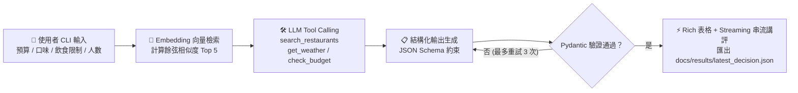

# 🍱 今日午餐吃什麼？智慧外送決策助手 (`lunch-decider`)

[](https://github.com/Tar0A0/lunch-decider/actions/workflows/ci.yml)
[](https://github.com/Tar0A0/lunch-decider/actions/workflows/pages.yml)

> **解決每天中午「不知道吃什麼、算運費湊單麻煩、怕誤踩同事飲食禁忌」的智慧外送決策 CLI 工具！**  
> 使用者只需輸入**預算上限、口味偏好、飲食限制、用餐人數與所在地區**，程式即結合 **Embedding 向量語意檢索**、**Tool Calling 工具呼叫**、**Pydantic 結構化輸出（含失敗自動重試）** 與 **Streaming 即時串流講評**，從本地 16 家多元餐廳資料庫中推薦最適合的 3 個外送選項。

🌐 **GitHub Pages 作品頁網址**：[https://tar0a0.github.io/lunch-decider/](https://tar0a0.github.io/lunch-decider/)（由 GitHub Actions 自動發布）

---

## ✨ 實作之 LLM 核心能力（4 項全滿）

本專案完整實作課程要求的全部 4 種 LLM 能力，對應程式碼位置如下：

| LLM 能力 | 實作檔案與函式 | 設計細節說明 |
| :--- | :--- | :--- |
| **1. 結構化輸出 (Structured Output)** | [`src/lunch_decider/schemas.py`](src/lunch_decider/schemas.py)<br>[`src/lunch_decider/llm.py`](src/lunch_decider/llm.py) | 使用 Pydantic v2 定義 `Recommendation` (`name`, `dishes`, `price`, `eta_minutes`, `calories_estimate`, `reason`, `score`) 與 `LunchDecisionResponse`。將 JSON Schema 傳入模型 `format` 參數，並實作 **`ValidationError` 自動重試機制（最多 3 次）**。 |
| **2. 工具呼叫 (Tool Calling)** | [`src/lunch_decider/tools.py`](src/lunch_decider/tools.py) | 定義 `TOOLS_SCHEMA` 並提供 3 個本地工具供模型呼叫：<br>1. `search_restaurants(max_price, taste, diet, cuisine, area)`<br>2. `get_weather(city)`（評估雨天對外送 ETA 與熱湯料理偏好的影響）<br>3. `check_budget(price_per_person, people, budget_per_person)`（計算滿 $300 免運門檻與人均分攤） |
| **3. 串流輸出 (Streaming)** | [`src/lunch_decider/llm.py`](src/lunch_decider/llm.py)<br>(`stream_chef_commentary`) | 使用 `httpx.stream` 逐 Token 即時串流印出「👨‍🍳 AI 外送決策主廚即時講評」，於終端機呈現打字機動態輸出。 |
| **4. 向量檢索 (Embedding 加分項)** | [`src/lunch_decider/embeddings.py`](src/lunch_decider/embeddings.py)<br>(`rank_restaurants_by_embedding`) | 將使用者查詢與 16 家餐廳菜單描述轉換為向量（支援 Ollama `/api/embed` 與內建 256 維中文字元 N-gram TF-IDF 向量器），計算 **Cosine Similarity（餘弦相似度）** 預篩出 Top 5 高相關候選餐廳。 |

---

## 🏗️ 系統架構與決策流程圖



---

## 📂 專案目錄結構

```text
lunch-decider/
├─ src/lunch_decider/
│  ├─ __init__.py
│  ├─ cli.py          # CLI 參數解析、Rich 終端機表格與串流顯示、結果檔匯出
│  ├─ llm.py          # Ollama / OpenAI / Gemini 切換、Tool Calling、結構化輸出與重試、串流
│  ├─ tools.py        # 餐廳搜尋、天氣查詢、多人免運預算試算工具與 TOOLS_SCHEMA
│  ├─ schemas.py      # Pydantic 資料驗證模型 (Restaurant, UserQuery, Recommendation)
│  └─ embeddings.py   # Embedding 向量化與餘弦相似度 (Cosine Similarity) 排名
├─ data/
│  └─ restaurants.json # 16 筆橫跨 13 種料理類型的本地外送餐廳與菜單資料
├─ tests/
│  ├─ test_schemas_and_tools.py  # 測試資料集、Pydantic 驗證與工具過濾邏輯
│  ├─ test_llm.py                # 測試 Tool Calling 與結構化輸出失敗重試機制
│  └─ test_embeddings_and_cli.py # 測試餘弦相似度、CLI --mock 模式與檔案匯出
├─ docs/              # GitHub Pages 作品頁靜態網站根目錄
│  ├─ index.html      # 作品頁（含四大評分區塊與動態 JSON 展示）
│  ├─ style.css       # 響應式卡片與深色主題樣式表
│  ├─ results/        # 自動匯出的最新執行結果 (latest_decision.json / .md)
│  └─ screenshots/    # 終端機實際執行畫面截圖
├─ .github/workflows/
│  ├─ ci.yml          # 自動執行 Ruff Linter、Pytest 單元測試與 CLI 驗證
│  └─ pages.yml       # 自動建置並部署 docs/ 至 GitHub Pages
├─ .env.example       # 環境變數設定範本（API Key 絕不寫入程式碼）
├─ .gitignore         # 嚴格排除 .env 與敏感金鑰檔案
├─ pyproject.toml     # uv 專案與相依套件設定檔
└─ uv.lock            # uv 鎖定依賴版本檔
```

---

## 🚀 安裝與執行步驟

### 1. 安裝 `uv`（若尚未安裝）

```bash
# macOS / Linux
curl -LsSf https://astral.sh/uv/install.sh | sh

# Windows (PowerShell)
powershell -ExecutionPolicy ByPass -c "irm https://astral.sh/uv/install.ps1 | iex"
```

### 2. 複製專案並安裝依賴套件

```bash
git clone https://github.com/Tar0A0/lunch-decider.git
cd lunch-decider

# 建立虛擬環境並安裝所有執行與開發依賴
uv sync --dev
```

### 3. 設定環境變數（本地 Ollama 或雲端模型切換）

複製 [`.env.example`](.env.example) 為 `.env`（`.env` 已列入 `.gitignore`，不會被上傳至 GitHub）：

```bash
cp .env.example .env
```

| 環境變數名稱 | 預設值 | 說明 |
| :--- | :--- | :--- |
| `LLM_PROVIDER` | `ollama` | 可選 `ollama`（本地預設）、`openai` 或 `gemini` |
| `OLLAMA_BASE_URL` | `http://localhost:11434` | 本地 Ollama 服務網址 |
| `OLLAMA_MODEL` | `qwen2.5:7b` | 使用的本地模型名稱（亦可使用 `llama3.1`） |
| `OPENAI_API_KEY` | （空） | 當 `LLM_PROVIDER=openai` 時必填 |
| `GEMINI_API_KEY` | （空） | 當 `LLM_PROVIDER=gemini` 時必填 |

### 4. 執行 CLI 智慧外送決策助手

```bash
# 方式 A：使用本地 Ollama 模型執行
uv run lunch --budget 150 --taste 辣 --diet 不吃牛 --people 2

# 方式 B：指定地區與素食條件
uv run lunch --budget 140 --taste 清爽 --diet 全素 --people 1 --area 台北市大安區

# 方式 C：使用 --mock 離線模式（不需啟動 LLM，適合快速驗證與 CI 測試）
uv run lunch --budget 150 --taste 辣 --diet 不吃牛 --people 2 --mock
```

每次執行完成後，程式除了在終端機印出彩色報表與串流講評外，也會自動將結果另存至：
- [`docs/results/latest_decision.json`](docs/results/latest_decision.json)
- [`docs/results/latest_decision.md`](docs/results/latest_decision.md)

---

## 🧪 執行自動化測試與程式碼檢查

```bash
# 執行 Ruff 語法與排版檢查
uv run ruff check .

# 執行 Pytest 單元測試（涵蓋 Schema 驗證、Tool Calling、重試機制、Embedding 與 CLI）
uv run pytest -v
```

---

## 🤖 AI 使用說明（工具、用途與人工驗證紀錄）

| 使用工具 | 用途與應用環節 | AI 輔助產出內容 | 開發者親自修改與驗證項目 |
| :--- | :--- | :--- | :--- |
| **Antigravity (Gemini)** | 餐廳資料設計與 `tools.py` 過濾邏輯 | 產生 16 家餐廳 JSON 與初步篩選函式 | **修正飲食禁忌誤判 Bug**：原本字串比對 `"牛" in tag` 會把標註「不吃牛可」的店家誤刪。我改為在 Schema 新增布林欄位 `contains_beef: bool`，並新增單元測試 `test_search_restaurants_respects_budget_and_no_beef` 驗證。 |
| **Antigravity (Gemini)** | `llm.py` 結構化輸出與重試機制 | 撰寫 Ollama `/api/chat` 呼叫與 Pydantic 解析 | **強化容錯與重試測試**：針對模型可能回傳 Markdown code fence 或 `score > 100` 的情況，加入正規表達式 JSON 擷取與最多 3 次的 `ValidationError` 回饋重試迴圈，並用 `httpx.MockTransport` 撰寫模擬測試驗證重試邏輯。 |
| **ChatGPT / Antigravity** | `embeddings.py` 向量語意檢索 | 提供餘弦相似度公式與 API 呼叫範例 | **實作離線保底向量器**：為確保沒有啟動外部 Embedding 服務或跑在 GitHub Actions CI 時仍能計算語意相似度，實作 256 維繁體中文字元 Unigram + Bigram TF-IDF 向量器，並驗證相似度排序正確性。 |
| **Antigravity (Gemini)** | GitHub Actions 與作品頁排版 | 生成 `ci.yml`、`pages.yml` 與 `docs/index.html` 初稿 | **權限把關與資安檢查**：確認 `pages.yml` 包含 `pages: write` 與 `id-token: write` 權限；在每次 commit 前檢查 `git status` 確保無任何 API Key 進入版本控制。 |
